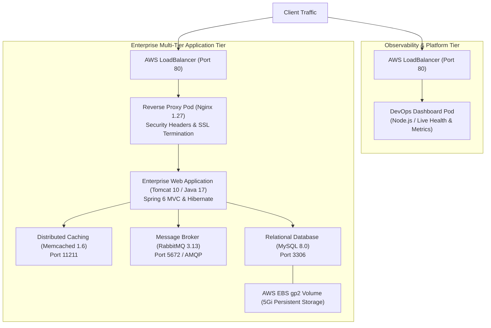

# Enterprise Multi-Tier Application & DevOps Platform on Amazon EKS

A production-grade, enterprise multi-tier architecture deployed on **Amazon Elastic Kubernetes Service (Amazon EKS)** using **GitHub Actions**, **Docker**, **Amazon ECR**, and **Terraform (IaC)**.

---

## Architecture Overview



---

## Tech Stack & Components

| Tier | Component | Technology | Role & Configuration |
| :--- | :--- | :--- | :--- |
| **Observability** | Platform Dashboard | Node.js (Alpine) | Real-time health monitoring, pod metrics, uptime, and architecture display |
| **Edge / Proxy** | Reverse Proxy | Nginx 1.27 Alpine | High-performance reverse proxy, security headers (`nosniff`, `SAMEORIGIN`), proxy buffering |
| **Application** | Core Business App | Apache Tomcat 10 / Java 17 | Multi-tier Spring 6 MVC web application running on Amazon Corretto JDK |
| **Cache** | In-Memory Cache | Memcached 1.6 Alpine | Session data and database query result caching |
| **Messaging** | Message Queue | RabbitMQ 3.13 Alpine | Asynchronous task queue and inter-service messaging |
| **Database** | Persistent Database | MySQL 8.0 | ACID-compliant transactional data storage backed by AWS EBS GP2 Persistent Volume |
| **CI/CD** | Pipeline Automation | GitHub Actions | Automated syntax checks, unit tests, multi-stage container builds, Trivy CVE scans, ECR push, and EKS rolling deployment |
| **IaC** | Cloud Infrastructure | Terraform v1.14 | Infrastructure as Code provisioning Amazon EKS, worker node groups, ECR registries, and IAM policies |

---

## Senior DevOps Best Practices Implemented

1. **Persistent Storage with AWS EBS CSI Driver**:
   - The MySQL database utilizes a Kubernetes `PersistentVolumeClaim` (PVC) bound to an AWS Elastic Block Store (EBS) `gp2` volume to guarantee zero data loss across pod restarts.
2. **InitContainer Dependency Synchronization**:
   - The Java web application uses lightweight `initContainers` (`busybox:1.36`) to actively poll the MySQL (`vprodb:3306`) and Memcached (`vprocache01:11211`) ports before the Tomcat container boots, preventing race conditions during cold starts.
3. **Decoupled Configuration & Secrets**:
   - Zero hardcoded credentials. Database passwords and RabbitMQ credentials are encrypted in Kubernetes `Secret` resources, while connection endpoints and database names are injected via `ConfigMap`.
4. **Automated Database Initialization**:
   - SQL schema and seed data are mounted directly via a Kubernetes `ConfigMap` into `/docker-entrypoint-initdb.d/`, ensuring automatic bootstrapping without manual DB intervention.
5. **Security Scanning (DevSecOps)**:
   - Every container image undergoes automated vulnerability scanning via **Trivy** in the CI pipeline before admission to Amazon ECR.
6. **Graceful Rolling Updates**:
   - Kubernetes `RollingUpdate` deployment strategy (`maxSurge: 1`, `maxUnavailable: 0`) paired with comprehensive `startupProbe`, `livenessProbe`, and `readinessProbe` ensures zero-downtime releases.

---

## Repository Structure

```text
Task-Vprofile-EKS/
├── .github/workflows/
│   └── deploy.yml               # Complete 3-Phase CI/CD Pipeline
├── app/
│   ├── pom.xml                  # Maven Project Object Model (Spring 6 / Java 17)
│   └── src/                     # Java source code, JSP views, resources
├── dashboard/
│   ├── package.json             # Dashboard service definition
│   ├── src/server.js            # Node.js metrics collector & dark dashboard UI
│   └── test/server.test.js      # Automated unit tests
├── docker/
│   ├── app/Dockerfile           # Multi-stage Maven -> Tomcat 10 container
│   ├── dashboard/Dockerfile     # Hardened Node.js Alpine container
│   └── proxy/                   # Nginx reverse proxy Dockerfile & nginx.conf
├── k8s/
│   ├── 00-namespace.yaml        # Dedicated namespace (enterprise-stack)
│   ├── 01-secret.yaml           # Database & message broker credentials
│   ├── 02-configmap.yaml        # Service hostnames and network ports
│   ├── 02-db-init-configmap.yaml# Database schema and seed data ConfigMap
│   ├── 03-db-pvc.yaml           # EBS PersistentVolumeClaim
│   ├── 04-db-deployment.yaml    # MySQL 8.0 Deployment & ClusterIP Service
│   ├── 05-cache-deployment.yaml # Memcached Deployment & ClusterIP Service
│   ├── 06-rmq-deployment.yaml   # RabbitMQ Deployment & ClusterIP Service
│   ├── 07-webapp-deployment.yaml# Tomcat Web Application & Probes
│   ├── 08-proxy-deployment.yaml # Nginx Reverse Proxy (LoadBalancer Service)
│   └── 09-dashboard-deployment.yaml # DevOps Dashboard (LoadBalancer Service)
├── terraform/
│   └── main.tf                  # EKS Cluster, Node Group, and 3x ECR Repositories
└── README.md                    # Project Architecture & Operations Documentation
```

---

## Author & Verification
- **DevOps Engineer**: Ankit Gawade (`gawadeAnkit`)
- **Cloud Provider**: Amazon Web Services (AWS)
- **Region**: `us-east-1`
